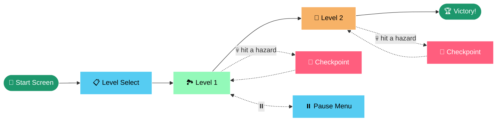

<p align="center">
  
</p>

<p align="center">
  
</p>

<p align="center">
  
  
  
  
  
</p>

---

<h2 align="center">🕹️ THE GAME</h2>

<p align="center">
A fast, bite-sized <b>2D pixel-art platformer</b>.<br/>
Run, jump and ride moving platforms through hand-built levels packed with <b>spikes</b> and <b>spinning saws</b>.<br/>
Collect every 🍌 banana, hit the checkpoints, and reach the 🏁 <b>finish flag</b>.
</p>

---

<h2 align="center">🗺️ GAME FLOW</h2>



---

<p align="center">
  
</p>

---

<h2 align="center">🎮 CONTROLS</h2>

<table align="center">
<tr><th>Action</th><th>⌨️ Keyboard</th><th>📱 Touch</th></tr>
<tr><td>🏃 Move</td><td><kbd>A</kbd> <kbd>D</kbd> / <kbd>←</kbd> <kbd>→</kbd></td><td>On-screen joystick</td></tr>
<tr><td>🦘 Jump</td><td><kbd>Space</kbd></td><td>Jump button</td></tr>
<tr><td>⏸️ Pause · Resume · Restart</td><td colspan="2" align="center">On-screen pause button</td></tr>
</table>

---

<p align="center">
  
</p>

---

<h2 align="center">🚀 RUN IT</h2>

```bash
git clone https://github.com/vishwaMoger/VishwaMoger_MiniPlatformer.git
```

1. Open the folder in **Unity 2022.3 LTS**.
2. Open `Assets/Scenes/MainMenu.unity`.
3. Press ▶️ **Play**.

---

<p align="center">
  <br/>
  <b>Made with ❤️ and 🍌 by <a href="https://github.com/vishwaMoger">Vishwa Moger</a></b><br/>
  <sub>Game Developer · 3+ years · Bangalore, India</sub>
</p>


